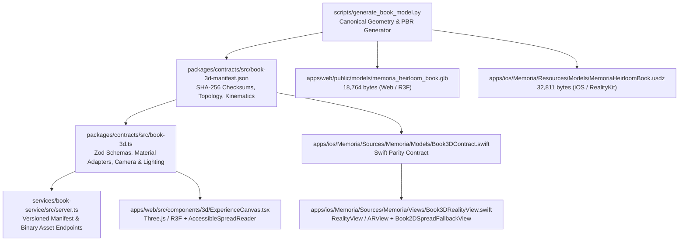

# Memoria — Unified Cross-Platform 3D Book Engine Architecture

**Product:** Memoria  
**Tagline:** Your memories, made timeless.  
**Engine Version:** 2.0.0 (`memoria_heirloom_book_v2`)  
**Platforms:** Web / PWA (Three.js + React Three Fiber) & Native iOS (SwiftUI + RealityKit)  
**Theme Governance:** Living Archive Light-Only (`#F7F4EE` Warm Ivory canvas, `#76556F` Muted Plum default binding)  
**Infrastructure Constraint:** $0 Budget, Local-First, Cardless  

---

## 1. Architectural Overview

The Memoria 3D Book Engine provides a single-source-of-truth interactive heirloom book experience across Web/PWA and Native iOS. Instead of maintaining divergent 3D models, hardcoded colors, or inconsistent animation curves per platform, every renderer consumes the same canonical geometry, scene graph hierarchy, PBR material specs, camera presets, lighting intent, and hinge kinematics.



---

## 2. Canonical Scene Graph & Articulated Hierarchy

Both `.glb` and `.usdz` assets share an identical articulated node hierarchy (dimensions in **meters**, `Y`-up, right-handed):

```text
HeirloomBookRoot (defaultPrim, 0.20m × 0.26m × 0.029m)
├── Spine                 [MutedPlumLeather, cambered 20-step arch]
├── BackCover             [MutedPlumLeather, 3.5mm binder's board]
├── TextBlock             [ArchivalPaperIvory, 22mm cotton-rag stack]
├── SilkRibbonBookmark    [SilkRibbonSage, #849483 satin marker]
├── FrontCoverHinge       [Pivot: (0, 0, 0), Rotation Axis: +Z]
│   ├── FrontCover        [MutedPlumLeather, 3.5mm binder's board]
│   ├── TreeOfLifeEmblem  [MetallicGoldFoil, 32-segment beveled medallion]
│   └── CornerGuards      [MetallicGoldFoil, brass corner brackets]
└── TurningPageHinge      [Pivot: (0.005, 0.0099, 0), Rotation Axis: +Z]
    └── TurningPageLeaf   [ArchivalPaperIvory, 16-step parabolic curl mesh]
```

### Winding & Kinematics Invariant
- All outward-facing triangles in both GLB and USDZ use **counter-clockwise (CCW)** vertex winding matching outward vertex normals (`dot(cross(p1-p0, p2-p0), n) > 0`), with `doubleSided = true` enabled for page leaves and thin surfaces.
- Because the spine sits along the `Z` axis at `X = 0` and the front cover extends along `+X` (`0` to `0.20m`) above the text block (`+Y`), opening the cover or turning a page requires a **positive** rotation around `+Z` (`0` → `+2.764` rad for `FrontCoverHinge`, `0` → `+2.88` rad for `TurningPageHinge`), lifting the cover upward (`+Y`) and swinging left (`-X`) without clipping through the text block.

---

## 3. Shared Contracts & Platform Renderers

### 3.1 Shared Contracts (`packages/contracts/src/book-3d.ts`)
- Exported via `@memory-capsule/contracts` and browser-safe subpath `@memory-capsule/contracts/book-3d`.
- Defines:
  - `Book3DManifestSchema` & `CANONICAL_BOOK_3D_MANIFEST`
  - `Book3DConfigurationSchema` & `DEFAULT_BOOK_3D_CONFIGURATION`
  - `BOOK_LEATHER_SWATCHES` (Muted Plum default `#76556F`, Archival Navy `#16233B`, Vintage Burgundy `#3B141C`, Midnight Onyx `#1C1C1E`, Heirloom Emerald `#1B382B`)
  - `BOOK_FOIL_SWATCHES` (Metallic Gold `#D4AF37`, Rose Gold `#B76E79`, Sterling Silver `#C0C0C0`, Blind Emboss)
  - `BOOK_CAMERA_PRESETS` (`hero`, `open_spread`, `spine_detail`, `emblem_closeup`, `top_down`)
  - `BOOK_LIGHTING_INTENT` (`LivingArchiveWarmMuseum` on Warm Ivory `#F7F4EE`)
  - `BOOK_ANIMATION_CONTRACT` (`easeInOutCubic` interpolation + page curl math)
  - Platform adapters: `toThreeMaterialParams()` and `toRealityKitMaterialParams()`

### 3.2 Backend Asset Delivery (`services/book-service/src/server.ts`)
- `GET /api/v1/books/3d/manifest` and `GET /api/v1/books/3d/manifest/:version`: Serves versioned manifest and engine contracts with `ETag` and `304 Not Modified` support.
- `GET /api/v1/books/3d/assets/:assetKey`: Serves `memoria_heirloom_book.glb` (`model/gltf-binary`) and `MemoriaHeirloomBook.usdz` (`model/vnd.usdz+zip`) from a strict allowlist (preventing path traversal), verifies SHA-256 checksums against the manifest, and attaches `X-Asset-Sha256`, `ETag`, and immutable cache headers when versioned (`?v=2.0.0`).
- `GET /api/v1/books/:id/3d-model`: Resolves a book's persisted cover binding and foil configuration into a `Book3DConfiguration` payload (supports `sample` for unauthenticated teaser inspection).

### 3.3 Web / PWA Renderer (`apps/web/src/components/3d/`)
- `ExperienceCanvas.tsx`: Loads `/models/memoria_heirloom_book.glb?v=2.0.0` via `useGLTF`, binds `FrontCoverHinge` and `TurningPageHinge`, applies `THREE.MeshPhysicalMaterial` instances from `toThreeMaterialParams`, provides smooth damped `CameraPresetController`, pointer-drag page turning, keyboard shortcuts (`ArrowLeft`/`ArrowRight`, `Space`, `R`, `2`), and `prefers-reduced-motion` support.
- `CanvasErrorBoundary.tsx` + `checkWebGLSupport()` + `webglcontextlost` listener: Automatically switches to `AccessibleSpreadReader.tsx` if WebGL is unavailable or fails.
- `AccessibleSpreadReader.tsx`: Full WCAG 2.2 AA 2D archival spread reader alternative.

### 3.4 Native iOS RealityKit Renderer (`apps/ios/Memoria/Sources/Memoria/`)
- `Models/Book3DContract.swift`: 1:1 Swift parity models (`BookLeatherSwatch`, `BookFoilSwatch`, `BookCameraPreset`, `BookAnimationContract`, `Book3DAssetLocator`).
- `Views/Book3DRealityView.swift`: Uses `RealityView` (`content.camera = .virtual`) on iOS 18+ with an `ARView(cameraMode: .nonAR)` fallback on iOS 17, asynchronously loading `MemoriaHeirloomBook.usdz` from `Bundle.main`, driving hinge and page-turn animations via `SceneEvents.Update`, applying `PhysicallyBasedMaterial` swaps, studio directional/point lighting, `SpatialTapGesture` + `DragGesture` + `MagnifyGesture`, and light haptic feedback.
- `Views/Book3DReaderView.swift` & `Views/BookshelfView.swift`: Live 3D shelf card preview, full interactive 3D reader with camera presets and material customizer sheet, and `Book2DSpreadFallbackView.swift` accessible 2D spread reader.
