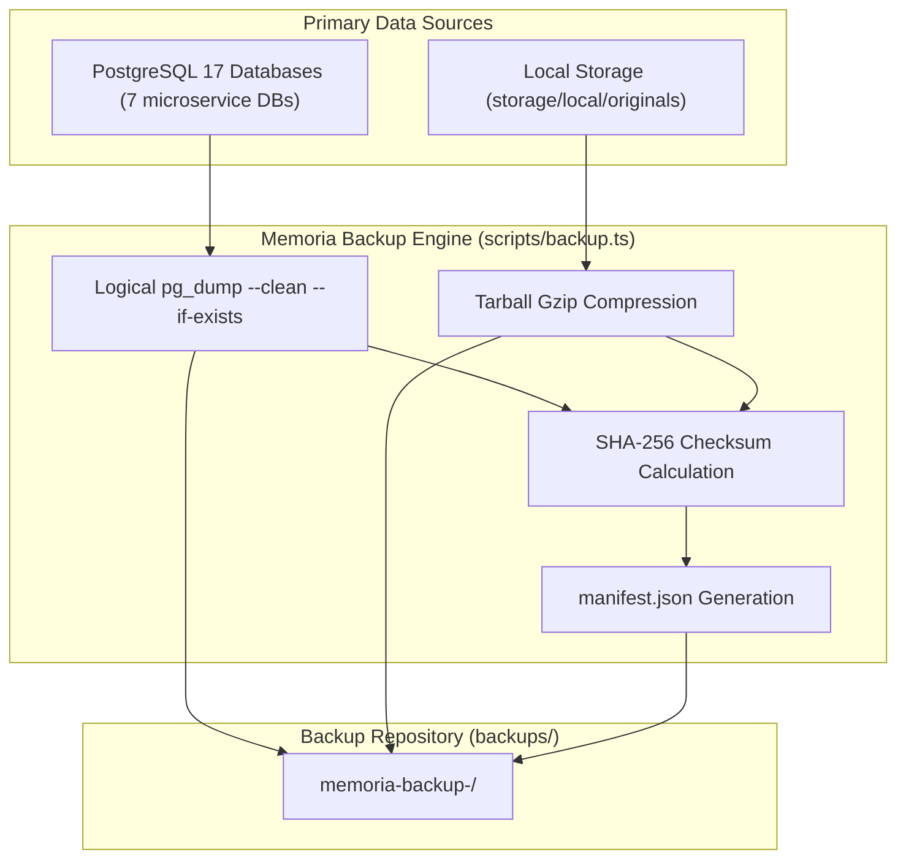

# MEMORIA — DATABASE & MEDIA BACKUP AND RECOVERY SPECIFICATION

**Product:** Memoria  
**Tagline:** Your memories, made timeless.  
**Target RDBMS:** PostgreSQL 17.x  
**Budget Policy:** Absolute $0 (Local-First, Zero Cloud Subscriptions)

---

## 1. Zero-Loss Architecture Overview

Memoria employs a hybrid backup strategy ensuring independent recovery of both relational metadata and raw binary media assets:



---

## 2. Microservice Database Dumps

Every microservice maintains an isolated database dumped via `pg_dump`:

| Database | Ownership | Included Tables |
| :--- | :--- | :--- |
| `identity_db` | Identity Service | `users`, `sessions`, `credentials` |
| `memory_db` | Memory Service | `memory_spaces`, `space_profiles`, `memories` |
| `media_db` | Media Service | `media_assets`, `media_derivatives`, `space_storage_usage` |
| `collab_db` | Collaboration Service | `invitations`, `memberships`, `activity_logs` |
| `book_db` | Book Studio Service | `books`, `book_editions`, `chapters`, `page_layouts` |
| `commerce_db` | Commerce Service | `orders`, `fulfillment_records`, `shipping_profiles` |
| `notification_db` | Notification Service | `notification_templates`, `delivery_receipts` |

---

## 3. Cryptographic Manifest Specification

Every backup directory contains `manifest.json`:

```json
{
  "backupId": "memoria-backup-2026-11-09T16-28-27-179Z",
  "createdAt": "2026-11-09T16:28:27.193Z",
  "postgresVersion": "psql (PostgreSQL) 17.10 (Homebrew)",
  "databases": [
    {
      "name": "memory_db",
      "dumpFile": "databases/memory_db.sql",
      "sizeBytes": 52940,
      "sha256": "8b6be26eef4695015b63013d33ff61d198889b7fae4eb245b786d34e9e144a19",
      "recordCounts": {
        "memory_spaces": 1,
        "memories": 6
      }
    }
  ],
  "mediaArchive": {
    "file": "media-storage.tar.gz",
    "sizeBytes": 5120,
    "sha256": "e4add8979e27c191a3299c82c2e99f430c45d3c8c4a169b2d39aa4789547d6e6"
  },
  "totalSizeBytes": 128940,
  "status": "COMPLETE"
}
```

---

## 4. Retention Policy

The backup engine automatically enforces a 7-day rolling window:
- Keeps up to 7 most recent backups.
- Never deletes older backups if fewer than 3 total backups exist in the repository.
- Pruning runs atomically at the conclusion of every successful backup.

---

## 5. Developer & Operational Commands

The backup and restoration workflow is executable through standard project scripts:

```bash
# 1. Create a complete point-in-time backup (Databases + Media Storage + Manifest)
pnpm run backup:create

# 2. Dry-run verify integrity of all dumps and hashes (zero mutations)
pnpm run backup:verify

# 3. Restore databases and media storage from latest backup
pnpm run backup:restore
```
