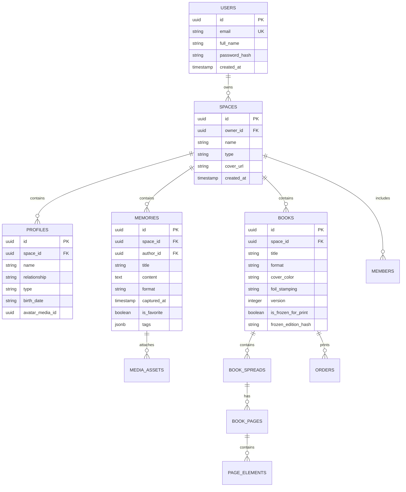

# Data Models & Relational Schema Specifications

## 1. Relational ER Diagram

## 2. Table Indices & Performance Rules
- `memories(space_id, captured_at DESC)`: B-tree compound index for sub-10ms timeline queries.
- `memories(space_id, is_favorite)`: Filtered index for favorites.
- `profiles(space_id)`: Foreign key index.
- `media_assets(space_id, status)`: Index for upload session confirmation and cleanup.

