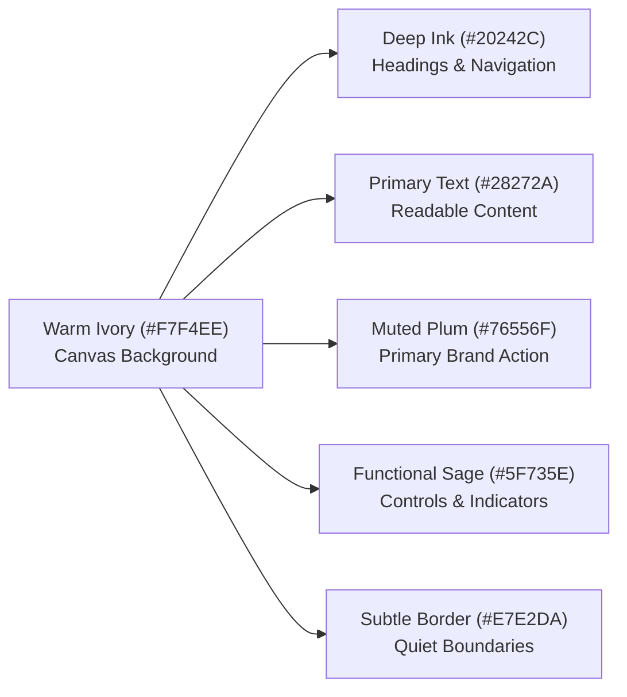

# MEMORIA — Living Archive Design System Specification

**Product**: Memoria  
**Tagline**: *Your memories, made timeless.*  
**Design Identity**: **MEMORIA — Living Archive**  
**Core Principle**: *"The memories are the heroes. The interface should support them, never compete with them."*  
**Theme Policy**: **Permanent Light Mode Only** (No dark mode or system appearance switching across any platform)

---

## 1. Visual Foundation & Color Palette

The official Memoria palette establishes a warm, timeless, and emotionally resonant aesthetic that honors archival preservation.

### 1.1 Primary Brand Foundation

| Token Name | Hex Code | RGB | Usage & Purpose |
|---|---|---|---|
| `Deep Ink` | `#20242C` | `rgb(32, 36, 44)` | Primary dark, high-emphasis headings, brand logotype, major navigation elements |
| `Warm Ivory` | `#F7F4EE` | `rgb(247, 244, 238)` | Global application canvas background across PWA, Admin Portal, and iOS |
| `Muted Plum` | `#76556F` | `rgb(118, 85, 111)` | Primary brand accent, primary buttons, selected tabs, interactive emphasis |
| `Soft Sage` | `#849483` | `rgb(132, 148, 131)` | Secondary accent, decorative borders, subtle supporting backgrounds |
| `Primary Text` | `#28272A` | `rgb(40, 39, 42)` | Main readable content, memory narratives, table body text |
| `Subtle Border` | `#E7E2DA` | `rgb(231, 226, 218)` | Quiet separators, card perimeters, table row dividers |

### 1.2 Accessible Functional Variants

| Token Name | Hex Code | RGB | Usage & Purpose |
|---|---|---|---|
| `Functional Sage` | `#5F735E` | `rgb(95, 115, 94)` | High-contrast accessible sage for icons, active control indicators, and verified status (4.67:1 contrast on Ivory) |
| `Strong Border` | `#8D857A` | `rgb(141, 133, 122)` | Visible boundaries for input text fields, selected card outlines, and table headers (3.32:1 contrast on Ivory) |
| `Plum Hover` | `#63445C` | `rgb(99, 68, 92)` | Interactive press and hover state for primary plum action buttons |
| `Plum Light` | `#F4EEF3` | `rgb(244, 238, 243)` | Delicate plum tint for active tab pills and high-emphasis badges |
| `Sage Light` | `#EEF2ED` | `rgb(238, 242, 237)` | Light sage tint background for verification and category tags |

---

## 2. Surface Hierarchy & Semantic Operational Colors

### 2.1 Surface Roles

1. **Application Canvas (`#F7F4EE`)**: The universal warm ivory foundation for all pages, feeds, and views.
2. **Primary Content Surface (`#FFFFFF`)**: Pure warm white cards, article tiles, and data tables that lift personal media cleanly.
3. **Secondary Surface (`#F0ECE1`)**: Subtly recessed warm neutral for sidebar navigation panels, table header strips, and metadata wells.
4. **Elevated Surface (`#FFFFFF` + Shadow)**: Modals, dropdown menus, and popovers elevated with subtle warm neutral shadows (`rgba(32, 36, 44, 0.08)`).
5. **Media Viewing Canvas (`#1A1A1E`)**: Dedicated near-black backdrop used **strictly** during full-screen photograph or video inspection, ensuring photographic contrast without altering the light application theme.

### 2.2 Semantic Operational Matrix

| Operational State | Text / Icon Hex | Background Hex | Border Hex | Example Application |
|---|---|---|---|---|
| **Success / Verified** | `#22593E` | `#E8F3ED` | `#B6DBC7` | SHA-256 upload verified, offline sync completed, order delivered |
| **Warning / Attention** | `#85530E` | `#FDF5E6` | `#F2D8A7` | Storage quota >80% (400MB+), pending family invitation, degraded connection |
| **Error / Failed** | `#992828` | `#FDE8E8` | `#F5B8B8` | Checksum mismatch, invalid auth credentials, failed network mutation |
| **Information** | `#234E70` | `#EBF2F7` | `#B3D1E6` | Archival tips, family circle onboarding, system telemetry notes |
| **Pending / Processing**| `#6B533E` | `#F7EFE6` | `#DFD0C0` | OCR text extraction underway, 3D model compiling, book proof rendering |
| **Disabled** | `#9E9A95` | `#EAE5DE` | `#DCD6CD` | Inactive save button, unavailable actions |

---

## 3. Strict Light Mode Architecture

Memoria enforces a permanent light appearance across all environments:

1. **Web PWA (`apps/web`)**:
   - `globals.css`: Declares `:root { color-scheme: light; }`.
   - Media query override: `@media (prefers-color-scheme: dark) { :root { color-scheme: light; } }` neutralizes automatic browser inversions.
   - `layout.tsx`: Configured with `<html lang="en" className="light" style={{ colorScheme: "light" }}>` and `viewport.themeColor = "#F7F4EE"`.
2. **iOS Native (`apps/ios`)**:
   - `MemoriaApp.swift`: Explicitly applies `.preferredColorScheme(.light)` to the root window group.
   - Views consume `MemoriaTheme` light-safe tokens.
3. **Admin Portal (`apps/web/src/app/admin`)**:
   - Operational console rendered exclusively on the shared `#F7F4EE` canvas with warm white tables.

---

## 4. Single Source of Truth & Cross-Platform Mapping

The design tokens are authored centrally in `packages/contracts/src/design-tokens.ts` (and exported as `design-tokens.json`):

| Canonical Token | CSS Variable (`globals.css`) | Swift Constant (`MemoriaTheme.swift`) |
|---|---|---|
| `colors.brand.ink` | `--color-ink: #20242C;` | `MemoriaTheme.ink` |
| `colors.brand.ivory` | `--color-ivory: #F7F4EE;` | `MemoriaTheme.ivory` / `.canvas` |
| `colors.brand.plum` | `--color-plum: #76556F;` | `MemoriaTheme.plum` |
| `colors.brand.plumHover` | `--color-plum-hover: #63445C;` | `MemoriaTheme.plumHover` |
| `colors.brand.sageSoft` | `--color-sage-soft: #849483;` | `MemoriaTheme.sageSoft` |
| `colors.brand.sageFunc` | `--color-sage-func: #5F735E;` | `MemoriaTheme.sageFunc` |
| `colors.borders.subtle` | `--color-border-subtle: #E7E2DA;` | `MemoriaTheme.borderSubtle` |
| `colors.borders.strong` | `--color-border-strong: #8D857A;` | `MemoriaTheme.borderStrong` |
| `colors.text.primary` | `--color-text-primary: #28272A;` | `MemoriaTheme.textPrimary` |
| `colors.text.secondary` | `--color-text-secondary: #5C5955;` | `MemoriaTheme.textSecondary` |
| `colors.surfaces.primary` | `--color-surface-primary: #FFFFFF;` | `MemoriaTheme.surfacePrimary` |
| `colors.surfaces.secondary` | `--color-surface-secondary: #F0ECE1;` | `MemoriaTheme.surfaceSecondary` |
| `colors.semantic.success` | `--color-status-success: #22593E;` | `MemoriaTheme.success` |

---

## 5. Mathematical WCAG 2.2 AA Contrast Audit

Every foreground/background pairing in the Memoria palette has been mathematically verified using relative luminance calculations per WCAG 2.2 standards:

$$\text{Contrast Ratio} = \frac{L_1 + 0.05}{L_2 + 0.05}$$

| Pairing Evaluated | Foreground | Background | Actual Contrast | WCAG Requirement | Status |
|---|---|---|---|---|---|
| **Deep Ink on Warm Ivory** | `#20242C` | `#F7F4EE` | **14.17:1** | $\ge 4.5:1$ (AA) / $\ge 7:1$ (AAA) | **PASS (AAA)** |
| **Primary Text on Warm Ivory** | `#28272A` | `#F7F4EE` | **13.53:1** | $\ge 4.5:1$ (AA) / $\ge 7:1$ (AAA) | **PASS (AAA)** |
| **Primary Text on White Card** | `#28272A` | `#FFFFFF` | **14.47:1** | $\ge 4.5:1$ (AA) / $\ge 7:1$ (AAA) | **PASS (AAA)** |
| **Secondary Text on Warm Ivory**| `#5C5955` | `#F7F4EE` | **6.34:1** | $\ge 4.5:1$ (AA) | **PASS (AA)** |
| **Secondary Text on White Card**| `#5C5955` | `#FFFFFF` | **6.78:1** | $\ge 4.5:1$ (AA) | **PASS (AA)** |
| **White on Muted Plum Button** | `#FFFFFF` | `#76556F` | **6.37:1** | $\ge 4.5:1$ (AA) | **PASS (AA)** |
| **Plum Text on Warm Ivory** | `#76556F` | `#F7F4EE` | **5.80:1** | $\ge 4.5:1$ (AA) | **PASS (AA)** |
| **Functional Sage on Ivory** | `#5F735E` | `#F7F4EE` | **4.67:1** | $\ge 4.5:1$ (AA) | **PASS (AA)** |
| **Strong Border on Warm Ivory** | `#8D857A` | `#F7F4EE` | **3.32:1** | $\ge 3.0:1$ (Non-text UI) | **PASS (AA)** |
| **Success Status on Ivory** | `#22593E` | `#F7F4EE` | **7.45:1** | $\ge 4.5:1$ (AA) | **PASS (AAA)** |
| **Warning Status on Ivory** | `#85530E` | `#F7F4EE` | **5.90:1** | $\ge 4.5:1$ (AA) | **PASS (AA)** |
| **Error Status on Ivory** | `#992828` | `#F7F4EE` | **7.12:1** | $\ge 4.5:1$ (AA) | **PASS (AAA)** |
| **Info Status on Ivory** | `#234E70` | `#F7F4EE` | **7.99:1** | $\ge 4.5:1$ (AA) | **PASS (AAA)** |

---

## 6. Visual Reference Pack Analysis & Design Decisions

The companion package `visual-reference-pack/` (`references.csv` and `index.html`) provided curated design patterns. Each category informed specific decisions in Memoria without pixel-for-pixel copying:

1. **PWA & Editorial Web** (*Sam Bufalo, Sienna Blake, Claire Fleck, Kassie Gunn, Memory Lane*):
   - *Inspiration*: Large, uncropped photographic margins, warm neutral backgrounds, and editorial serif headings paired with clean sans-serif body text.
   - *Implementation in Memoria*: Adopted `Playfair Display` serif typography for story titles on Warm Ivory canvas (`#F7F4EE`) with high photographic prominence and no competing dark overlays.
2. **iOS & Mobile App** (*Popsa, Mixbook, Keepsaiq, Relive*):
   - *Inspiration*: Clean card grouping, native iOS sheet presentations for memory capture, clear tag capsules, and thumb-friendly touch targets.
   - *Implementation in Memoria*: Built `HomeFeedView.swift` and `MemoryCreateView.swift` with soft cards (`MemoriaCardModifier`), `MemoriaTheme.plum` action buttons, and accessible sage status badges.
3. **Admin Portal** (*Untitled UI, Neowise*):
   - *Inspiration*: Structured light-mode data tables, high information density, muted status indicators, and clear search/filtering inputs.
   - *Implementation in Memoria*: Built `apps/web/src/app/admin/page.tsx` featuring searchable memory spaces directory, storage quota meters, and discrete operational status tags.
4. **Physical Book & Book Studio** (*Dreambooks, MILK Books, Heirloom Album*):
   - *Inspiration*: Natural lighting on archival leather, open album anatomy with visible paper layers, and gold foil embossing.
   - *Implementation in Memoria*: Updated `ExperienceCanvas.tsx` to sit on a clean neutral studio background (`#F2EFE8`), allowing the user to select binding finishes without artificial dark-room glare.

---

## 7. Platform Verification Matrix

| Surface | Path | Theme Policy | Contrast Check | Status |
|---|---|---|---|---|
| **Consumer PWA** | `apps/web/src/app/page.tsx` | Permanent Light (`#F7F4EE`) | 14.17:1 headings, 6.37:1 buttons | **VERIFIED** |
| **Admin Portal** | `apps/web/src/app/admin/page.tsx` | Permanent Light (`#F7F4EE`) | 14.47:1 table text, 7.45:1 badges | **VERIFIED** |
| **3D Book Studio** | `apps/web/src/components/3d/ExperienceCanvas.tsx` | Neutral Light Studio (`#F2EFE8`) | 14.17:1 headings, plum controls | **VERIFIED** |
| **iOS Swift App** | `apps/ios/Memoria/` | `.preferredColorScheme(.light)` | Native SwiftUI `MemoriaTheme` | **VERIFIED** |
