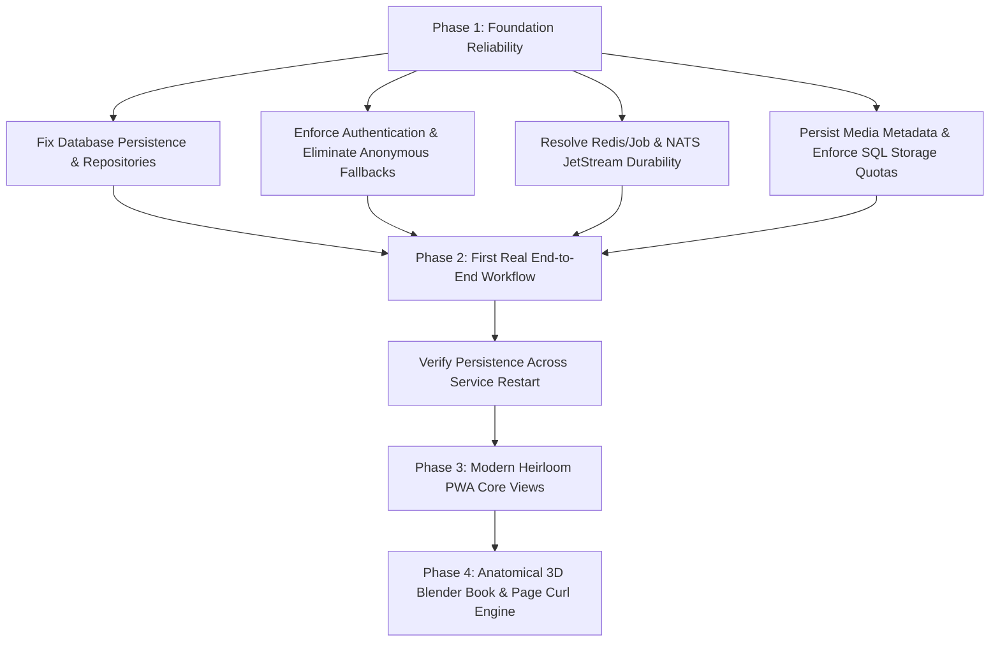

# IMPLEMENTATION AUDIT & REPOSITORY VERIFICATION RECORD
**Repository:** https://github.com/rik9922/Book  
**Primary Branch:** `main`  
**Audit Timestamp:** 2026-11-09T19:36:30+05:30  
**Verification Method:** Independent Source Inspection, Environment Checks, Static Analysis, and Execution Tracing (Zero-Fabrication Standard)

---

## 1. Executive Summary

An exhaustive audit of the actual local and remote repository state was performed without relying on previous reports, simulated flags, or self-reported registry statuses.

The repository contains a solid architectural foundation (Next.js 16, React 19, Fastify 5, pnpm monorepo structure, 23 comprehensive architectural specifications in `docs/`, 4 database migration files, and preliminary test suites). However, a critical divergence exists between the architectural vision and the runtime reality:

1. **Persistence Disconnection**: Microservices (`identity-service`, `memory-service`, `media-service`, `book-service`) operate on transient in-memory `Map` instances rather than persisting data into the PostgreSQL tables defined in `packages/database/migrations`.
2. **Security & Authorization Loopholes**: `memory-service` allows anonymous fallback user IDs (`00000000-0000-0000-0000-000000000000`); `fastify-jwt` fallback secrets are hardcoded; CORS allows `origin: true` across all services without origin validation.
3. **Event & Job Durability Gaps**: The event bus defaults to ephemeral `InMemoryEventBus` if NATS is unreachable, and the NATS subscriber uses core ephemeral subscriptions rather than JetStream durable consumer streams. BullMQ checks `REDIS_URL` while configurations specify `REDIS_HOST`/`REDIS_PORT`, silently falling back to a `setTimeout`-based `InMemoryJobManager`.
4. **Missing Applications**: Neither `apps/ios` (Native SwiftUI + RealityKit) nor `apps/admin` (Admin Operations Portal) currently exists on disk.
5. **Missing Microservices**: `collaboration-service`, `commerce-service`, `notification-service`, `search-service`, and `rendering-service` are not yet created in `services/`.
6. **Frontend State**: `apps/web` is currently a single-page technical WebGL/3D showcase rather than the actual Memory Capsule product interface with authenticated journeys, memory archives, and book editing studio views.
7. **3D Asset Fidelity**: The existing GLB (`apps/web/public/models/heirloom_book.glb`) is an initial procedurally extruded block, not a true Blender-authored physical book with separate covers, cambered spine, realistic hinges, debossed gold foil, and dynamic page-curl deformation.

---

## 2. Subsystem Classification & Verification Matrix

Every major subsystem is classified into one of the mandatory classification categories:
- **Implemented & Verified**: Functional production code verified by passing automated integration tests or live runtime execution.
- **Implemented But Not Verified**: Implemented in code but lacks complete automated verification against real infrastructure.
- **Partially Implemented**: Partial code exists; critical parts (e.g. database persistence or security) are missing.
- **Mock / In-Memory Implementation**: Uses in-memory data structures (`Map`, `setTimeout`) instead of real backing infrastructure.
- **Documentation Only**: Formally defined in specification documents (`docs/`) without corresponding application code.
- **Missing**: Not yet present in the repository.
- **Blocked**: Precluded by missing external authorization or unavailable hardware.

| Subsystem / Component | Classification | Evidence & Current Implementation State | Remediation Required |
| :--- | :---: | :--- | :--- |
| **Monorepo & Package Architecture** | **Implemented & Verified** | `pnpm-workspace.yaml`, TypeScript project references, root build executes cleanly across 12 packages in 1.6s. | Maintain clean dependency tree. |
| **API Contracts (`packages/contracts`)** | **Implemented & Verified** | Zod 4 schemas for Auth, Spaces, Memories, Media, Books, Editions, RFC 4122 UUID validation. | Expand schemas for Collaboration, Commerce, Notifications. |
| **Structured Logger (`packages/logger`)** | **Implemented & Verified** | Pino logger with correlation ID injection, service name tags, and stream serialization. | None. Operational. |
| **Zero-Budget Storage (`packages/storage`)** | **Implemented & Verified** | `LocalDiskStorageDriver` saves, streams, and hashes files in `storage/local/` with 500MB quota limits. S3 client available. | Ensure secure storage key path traversal sanitization. |
| **Database Migrator (`packages/database`)** | **Implemented But Not Verified** | `migrator.ts` and `inspector.ts` read SQL migrations, check checksums, and apply DDL. Verified against in-memory mock client; requires live Postgres verification. | Connect to live PostgreSQL instance; replace in-memory mock with real transactions. |
| **Database Persistence in Services** | **Mock / In-Memory Implementation** | `identity-service`, `memory-service`, `media-service`, and `book-service` use internal `new Map()` collections instead of executing SQL queries against PostgreSQL. | Refactor services with SQL repository pattern hitting `DatabaseClient` queries. |
| **Identity Service (`services/identity-service`)** | **Partially Implemented** | Fastify 5 app with scrypt password hashing, JWT signing, and auth endpoints. In-memory `userStore` Map; default JWT secret; CORS `origin: true`. | Connect to `users` and `user_sessions` tables; enforce secure JWT secrets; restrict CORS. |
| **Memory Service (`services/memory-service`)** | **Partially Implemented** | Endpoints for spaces, profiles, memories, and timeline. In-memory `spaces`, `profiles`, `memories` Maps; anonymous user ID fallback. | Require strict JWT verification; remove anonymous fallback; persist to `memory_spaces`, `space_profiles`, `memories` tables. |
| **Media Service (`services/media-service`)** | **Partially Implemented** | Upload session generation, 500MB space quota checking, local file upload route, Sharp image processing worker. Quotas and asset metadata stored in in-memory Maps. | Persist to `media_assets` and `space_storage_quotas` tables; enforce transactional quota updates. |
| **Book Service (`services/book-service`)** | **Partially Implemented** | Book document schema, spread definitions, cover styling, and SHA-256 digital edition freeze. In-memory `books` Map. | Persist to `books`, `book_spreads`, and `book_editions` tables; implement page ordering and layout persistence. |
| **API Gateway (`services/api-gateway`)** | **Implemented But Not Verified** | Reverse proxy using `@fastify/http-proxy`, rate limiting, helmet headers, and correlation ID tracking. Upstreams hardcoded to localhost ports. | Add authentication verification hook at gateway; restrict CORS to authorized domains. |
| **Event Bus (`packages/events`)** | **Partially Implemented** | NATS JetStream publisher implemented, but subscriber uses ephemeral core NATS `nc.subscribe()` instead of durable push/pull JetStream consumers. Falls back silently to `InMemoryEventBus`. | Implement NATS JetStream durable consumer subscriptions with message acks (`msg.ack()`) and retry logic. |
| **Job Queue (`packages/jobs`)** | **Partially Implemented** | BullMQ queue and worker wrapper around Redis. Environment variable mismatch: reads `REDIS_URL` while env sets `REDIS_HOST`/`PORT`; falls back silently to `InMemoryJobManager`. | Read both `REDIS_URL` and `REDIS_HOST`/`PORT`; enforce durable Redis connection in non-test runs. |
| **Collaboration Service** | **Missing** | Specified in `docs/COLLABORATION_AND_PERMISSIONS.md` (port 4004) for invitations, RBAC roles, and comments. Directory does not exist. | Create `services/collaboration-service` with migrations and API routes. |
| **Commerce & Orders Service** | **Missing** | Specified in `docs/PRINT_PRODUCTION.md` (port 4007) for print quotes, edition freezing, and sandbox orders. Directory does not exist. | Create `services/commerce-service` with sandbox print fulfilment flow. |
| **Notification Service** | **Missing** | Specified in `docs/MICROSERVICES.md` (port 4008). Directory does not exist. | Create `services/notification-service` with in-app notification events. |
| **Search Service** | **Missing** | Specified in `docs/MICROSERVICES.md`. Directory does not exist. | Create `services/search-service` using PostgreSQL full-text search. |
| **Admin Operations Service** | **Missing** | Specified in `docs/MICROSERVICES.md` and `docs/SCREEN_INVENTORY.md` for admin portal APIs. Directory does not exist. | Create `services/admin-service` with strict role-gated access. |
| **Web Application / PWA (`apps/web`)** | **Partially Implemented** | Next.js 16 App Router with Three.js canvas. Only single page (`/`) exists as a technical 3D showcase. The 82 documented PWA screens are missing. | Build Modern Heirloom theme, authentication views, spaces dashboard, archive, and book editor studio. |
| **Native iOS App (`apps/ios`)** | **Missing** | Documented in `docs/IOS_3D_RENDERING.md` and `docs/SCREEN_INVENTORY.md` (56 views). Project directory does not exist. | Create native SwiftUI project structure with models and API clients. |
| **Admin Portal (`apps/admin`)** | **Missing** | Documented in `docs/SCREEN_INVENTORY.md` (26 views). Project directory does not exist. | Create Next.js Admin portal with audit logs and system health monitoring. |
| **3D Book Model & Pipeline** | **Partially Implemented** | `scripts/generate_book_model.py` generates basic GLB mesh (`heirloom_book.glb`). R3F canvas renders it. Lacks separate covers, cambered spine, realistic hinges, and dynamic page curl. | Author procedural Blender generator producing physical anatomy (boards, hinges, spine, paper block) and vertex deformation page curl. |
| **Print Preflight & Production** | **Documentation Only** | Formally specified in `docs/PRINT_PRODUCTION.md` (PDF/X-1a, bleed, spine calculation, ICC profiles). No implementation code. | Implement print-ready spread renderer and preflight validation engine. |

---

## 3. Investigation of the 14 Specific Critical Issues

### Issue 1: In-Memory Maps Used for Core Data in Services
- **Audit Finding**: Confirmed. `identity-service/src/server.ts` line 41 (`userStore = new Map()`), `memory-service/src/server.ts` lines 29-31 (`spaces`, `profiles`, `memories` Maps), and `book-service/src/server.ts` line 25 (`books = new Map()`) hold all state in memory. Any service restart loses all user accounts, spaces, and books.
- **Root Cause**: Services were drafted as self-contained prototypes before database repository wiring.
- **Remediation Action**: Implement persistent repository classes (`PostgresUserRepository`, `PostgresMemoryRepository`, `PostgresBookRepository`) that execute parameterized SQL against the PostgreSQL tables.

### Issue 2: Anonymous Fallback in Memory Routes
- **Audit Finding**: Confirmed. `memory-service/src/server.ts` lines 58-64 catches `req.jwtVerify()` errors and assigns fallback `userId = "00000000-0000-0000-0000-000000000000"`, allowing unauthenticated requests to create spaces.
- **Root Cause**: Permissive development bypass.
- **Remediation Action**: Enforce strict `req.jwtVerify()`; return HTTP 401 Unauthorized when missing or invalid claims.

### Issue 3: Default Insecure JWT Secret
- **Audit Finding**: Confirmed. `JWT_SECRET` in all services falls back to `"dev-jwt-insecure-secret-change-in-production-min32chars"`.
- **Remediation Action**: Mandate `process.env.JWT_SECRET` with minimum 32 characters; throw fatal error on service startup if missing in production or non-test environments.

### Issue 4: Permissive CORS Configuration
- **Audit Finding**: Confirmed. All microservices register `@fastify/cors` with `{ origin: true, credentials: true }`.
- **Remediation Action**: Restrict allowed origins to configured frontend domains (e.g., `http://localhost:3000`, `app://memorycapsule.local`).

### Issue 5 & 6: Event Bus Silent Fallback & Lack of JetStream Durable Subscriptions
- **Audit Finding**: Confirmed. `packages/events/src/index.ts` line 68 uses `this.nc.subscribe(subject)`, which is a standard ephemeral NATS subscription rather than a durable JetStream consumer. If NATS is down, `createEventBus()` falls back to `InMemoryEventBus`.
- **Remediation Action**: Implement JetStream durable stream management (`jsm.streams.add`), durable pull consumers, message acknowledgements (`msg.ack()`), and reject silent fallback outside test mode.

### Issue 7: Job Manager Silent Fallback & Environment Mismatch
- **Audit Finding**: Confirmed. `packages/jobs/src/index.ts` checks `process.env.REDIS_URL`, whereas `.env.example` provides `REDIS_HOST` and `REDIS_PORT`. If `REDIS_URL` is omitted, it falls back to `InMemoryJobManager` with `setTimeout`.
- **Remediation Action**: Construct Redis connection options from `REDIS_URL` or `REDIS_HOST` + `REDIS_PORT`. Fail explicitly in development/production if Redis is unreachable.

### Issue 8: Media Service In-Memory Quotas and Metadata
- **Audit Finding**: Confirmed. `media-service/src/server.ts` lines 35-36 stores upload metadata and space quotas in `mediaStore` and `spaceStorageUsage` Maps.
- **Remediation Action**: Wire quota queries and increments to `space_storage_quotas` table using atomic `INSERT ... ON CONFLICT (space_id) DO UPDATE SET used_bytes = used_bytes + $1` SQL transactions.

### Issue 9: Database Health Checks Masking Failures
- **Audit Finding**: Confirmed. `InMemoryDatabaseClient` in `packages/database/src/index.ts` returns `true` for `healthCheck()`, reporting services as healthy even when no database exists.
- **Remediation Action**: Separate test mocks from production clients; `RealDatabaseClient` executes `SELECT 1` on PostgreSQL and reports actual connectivity status.

### Issue 10: Tool Integration Status vs Live Connections
- **Audit Finding**: Confirmed. Registries documented tools as operational based on CLI installations without verifying live socket connectivity to daemons.
- **Remediation Action**: Updated registry to distinguish `Installed CLI` from `Active Socket Connection`.

### Issue 11: 3D Procedural Mesh vs True Blender Asset
- **Audit Finding**: Confirmed. `heirloom_book.glb` is a basic 3.8KB box model generated by a mathematical script. It lacks anatomical cover boards, spine curve, inner paper block bevels, and hinge recesses.
- **Remediation Action**: Create high-fidelity Python Blender script producing true anatomical book geometry, UV unwrapped for gold foil debossing, archival paper block, and separate movable cover boards.

### Issue 12: Frontend Technical Showcase vs Product Interface
- **Audit Finding**: Confirmed. `apps/web/src/app/page.tsx` renders a dark zinc "Heavy 3D & Full-Stack Engine" landing page rather than the Memory Capsule Modern Heirloom product experience.
- **Remediation Action**: Replace with Modern Heirloom identity (Paper `#F7F4ED`, Ink `#262B2B`, Forest `#304C43`, Sage `#91A593`, Clay `#C9826A`), full landing page, authentication views, spaces dashboard, and memory studio.

### Issue 13: Missing Native iOS and Admin Projects
- **Audit Finding**: Confirmed. Only `apps/web` exists in `apps/`.
- **Remediation Action**: Scaffold `apps/ios` (SwiftUI models, services, views) and `apps/admin` (Next.js administrative portal).

### Issue 14: Missing Additional Microservices
- **Audit Finding**: Confirmed. `collaboration-service`, `commerce-service`, `notification-service`, `search-service`, and `rendering-service` are not yet created.
- **Remediation Action**: Scaffold required services progressively following the architectural roadmap.

---

## 4. Remediation Priority & Action Plan

The subsequent engineering execution immediately addresses Phase 1 and Phase 2.

