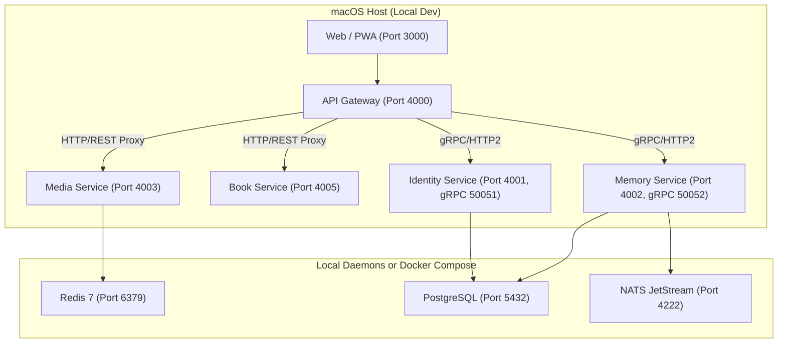

# Memoria — Centralized Local Development Port Inventory

This document defines the authoritative port assignments, protocols, service ownership, environment overrides, and network topology across the **Memoria** ecosystem.

The single programmatic source of truth is defined in [`packages/contracts/src/ports.ts`](../packages/contracts/src/ports.ts).

---

## 1. Authoritative Port Allocations

| Service ID | Service Name | Default Port | Protocol | Host Bind | Environment Variable | Service Type | Required | Description |
| :--- | :--- | :--- | :--- | :--- | :--- | :--- | :--- | :--- |
| `web` | Memoria Web / PWA | `3000` | HTTP/1.1 | `127.0.0.1` | `PORT_WEB` | Frontend | Yes | Next.js 16 PWA and Three.js 3D Book Viewer |
| `api-gateway` | Memoria API Gateway | `4000` | HTTP/1.1 | `0.0.0.0` | `PORT_GATEWAY` | Gateway | Yes | Fastify public REST API Gateway & gRPC translator |
| `identity-service` | Identity Service | `4001` | HTTP/1.1 | `127.0.0.1` | `PORT_IDENTITY` | Microservice | Yes | Authentication, user profiles, credentials & JWT |
| `memory-service` | Memory Service | `4002` | HTTP/1.1 | `127.0.0.1` | `PORT_MEMORY` | Microservice | Yes | Memory spaces, stories, timeline, tags & profiles |
| `media-service` | Media Service | `4003` | HTTP/1.1 | `127.0.0.1` | `PORT_MEDIA` | Microservice | Yes | Media uploads, Sharp derivatives & local disk storage |
| `collab-service` | Collaboration Service | `4004` | HTTP/1.1 | `127.0.0.1` | `PORT_COLLABORATION` | Microservice | No | Family member invitations, permissions & comments |
| `book-service` | Book Studio Service | `4005` | HTTP/1.1 | `127.0.0.1` | `PORT_BOOK` | Microservice | Yes | Photobook layout engine, PDF generation & draft state |
| `commerce-service` | Commerce & Print Service | `4007` | HTTP/1.1 | `127.0.0.1` | `PORT_COMMERCE` | Microservice | No | Print-on-demand vendor pipeline & order management |
| `notification-service` | Notification Service | `4008` | HTTP/1.1 | `127.0.0.1` | `PORT_NOTIFICATION` | Microservice | No | Email, push notifications & milestone reminders |
| `identity-grpc` | Identity Service (gRPC) | `50051` | gRPC/HTTP2 | `127.0.0.1` | `PORT_IDENTITY_GRPC` | gRPC Internal | Yes | High-speed internal user lookups & token validation |
| `memory-grpc` | Memory Service (gRPC) | `50052` | gRPC/HTTP2 | `127.0.0.1` | `PORT_MEMORY_GRPC` | gRPC Internal | Yes | High-speed internal memory retrieval & batch queries |
| `postgres` | PostgreSQL Database | `5432` | TCP / PG | `127.0.0.1` | `POSTGRES_PORT` | Database | Yes | Primary relational store (10 databases across services) |
| `redis` | Redis & BullMQ | `6379` | TCP / RESP | `127.0.0.1` | `REDIS_PORT` | Broker / Cache | Yes | Task queues, media background jobs & cache |
| `nats` | NATS JetStream (Client) | `4222` | TCP / NATS | `127.0.0.1` | `NATS_PORT` | Event Bus | Yes | Asynchronous domain events & outbox consumer |
| `nats-monitor` | NATS HTTP Monitoring | `8222` | HTTP | `127.0.0.1` | `NATS_MONITOR_PORT` | Monitoring | No | NATS internal server health & telemetry dashboard |
| `minio-api` | MinIO S3 API | `9000` | HTTP / S3 | `127.0.0.1` | `MINIO_PORT` | Storage | No | Optional local S3-compatible media object storage |
| `minio-console` | MinIO Web Console | `9001` | HTTP | `127.0.0.1` | `MINIO_CONSOLE_PORT` | Admin UI | No | MinIO web management UI |
| `pgadmin` | pgAdmin 4 | `5050` | HTTP | `127.0.0.1` | `PGADMIN_PORT` | Admin UI | No | Visual database administrator for PostgreSQL |

---

## 2. Dynamic Port Overrides

Any port can be dynamically overridden in `.env` without modifying repository source code.

Example `.env`:
```bash
# Shift Gateway and Web ports if 3000 or 4000 are occupied by local tools
PORT_WEB=3001
PORT_GATEWAY=4100
PORT_IDENTITY=4101
PORT_MEMORY=4102
```

When an override is provided, all dependent services and API gateway proxies automatically use the resolved port through `@memory-capsule/contracts`:
```typescript
import { resolveServicePort } from "@memory-capsule/contracts";

const gatewayPort = resolveServicePort("api-gateway"); // returns 4100
```

---

## 3. Host vs. Docker Container Topology

All Memoria backend services and web applications are designed to run directly on the host using Node.js / `tsx` for sub-second hot reload and native debugging.

Infrastructure services (Postgres, Redis, NATS) can run natively on macOS (via Homebrew) or in Docker Compose:



---

## 4. Port Conflict Prevention Invariant

1. **Explicit Binding Failure**: Every Fastify and gRPC server explicitly traps `EADDRINUSE`. The server will never silently crash or bind to an unpredictable random port.
2. **Mutual Exclusion Lock**: Orchestration scripts use `.memoria/memoria.lock` to prevent racing startup commands.
3. **PID Tracking**: Service PIDs are recorded in `.memoria/pids/<serviceId>.json` for deterministic, safe teardown. Unrelated host processes are never killed.

