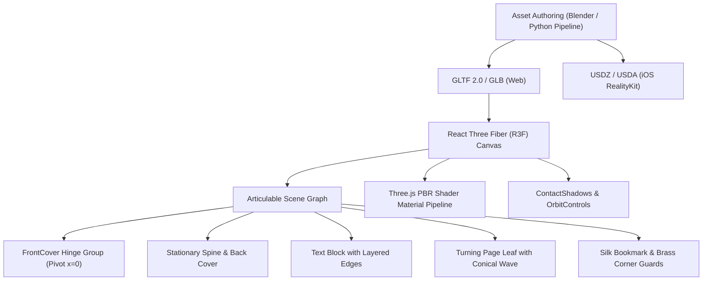

# Memoria — 3D Archival Reading Engine Architecture

**Product**: Memoria  
**Tagline**: Your memories, made timeless.  
**Platform**: Web (Three.js / React Three Fiber) and iOS (RealityKit / SceneKit)  
**Constraint**: $0 Budget, Local-First, 60 FPS Performance Budget  

---

## 1. Engine Vision & Purpose

Physical heirloom books have a tactile presence: the heft of archival binders board, the grain of vegetable-tanned leather, the glimmer of hot-stamped gold foil under light, and the gentle curl of ivory paper pages.

Memoria translates this physical intimacy into digital interactive 3D reading:
- On **Web/PWA**: Powered by Three.js and React Three Fiber (R3F), utilizing WebGL 2.0 with physically-based rendering (PBR), contact shadows, and dynamic debossed text.
- On **Native iOS**: Powered by RealityKit, utilizing Metal shaders, device motion / AR gyroscopes, and USDZ scene graphs.



---

## 2. Anatomical Node Hierarchy

Rather than loading a single monolithic mesh, Memoria dissects the physical book into independently articulable anatomical nodes:

```
HeirloomBookRoot
├── Spine (Cambered leather arch, radius R = textblock_t / 2 + board_t)
├── BackCover (Flat bound lower board resting at z = -textblock_t/2)
├── TextBlock (High-density paper stock block with recessed margins)
├── SilkRibbonBookmark (Gold woven ribbon draping across pages)
├── FrontHingeGroup (Pivots around hinge Y-axis at x = 0)
│   ├── FrontCover (Bound upper board with bevel chamfer)
│   ├── TreeOfLifeEmblem (Embossed golden medallion medallion)
│   ├── CornerGuards (Antique brass corner brackets)
│   └── DebossedFoilTitle (Dynamic 3D vector text with gold PBR finish)
└── TurningPageLeaf (Deformable leaf driven by conical page curl math)
```

---

## 3. Kinetic Physics & Page Curl Mechanics

### Cover Opening Physics
When opening or closing the book, the `FrontHingeGroup` rotates around its hinge joint ($x = 0$) using frame-rate independent spherical interpolation:
$$\theta_{t} = \text{lerp}(\theta_{current}, \theta_{target}, \Delta t \cdot k)$$
Where $\theta_{target} = -0.88\pi$ radians (approx $-158^\circ$) when open, and $0$ when closed.

### Conical Page Curl Geometry
Real paper does not bend like a rigid cylinder; it deforms across a conical apex anchored near the spine head. For an interactive page leaf, the height displacement $y(x, z)$ across width $x$ follows a parabolic curl equation:
$$y(x, z) = c \cdot \left(\frac{x}{w}\right)^2 + A \sin(\omega t) \cdot \left(\frac{z}{h}\right)$$
This produces a natural, tactile flutter under interactive inspection.

---

## 4. Cross-Platform Parity

| Feature | Web / PWA (Three.js / R3F) | iOS (RealityKit / SwiftUI) |
|---|---|---|
| Runtime | WebGL 2.0 / Three.js r180 | Metal / RealityKit 2 |
| File Format | Binary GLTF (`.glb`) | Universal Scene Description (`.usdz`) |
| PBR Model | Metallic-Roughness (Disney principled) | Physically Based Shader Graph |
| Shadowing | `ContactShadows` depth projection | Real-time scene directional shadows |
| Animation | Frame-rate independent lerp | CoreAnimation / RealityKit Timelines |

