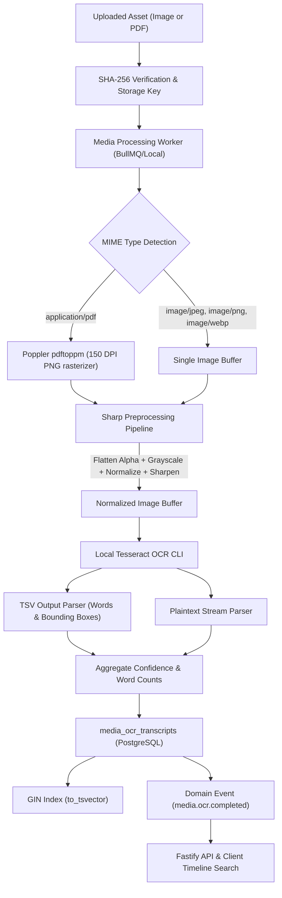

# Memoria — Local OCR Media Processing Architecture

**Product**: Memoria  
**Tagline**: Your memories, made timeless.  
**Component**: Media Service OCR Processing Pipeline  
**Constraint**: $0 Budget, Local-First, Offline-Capable, Cardless  

---

## 1. Architectural Overview

Archival memory books frequently contain historical documents: handwritten family letters, vintage postcards, newspaper clippings, birth certificates, and diplomas. To ensure these memories remain searchable across generations without exposing private family papers to commercial cloud vision providers, Memoria implements a local-first, zero-cost OCR pipeline.



---

## 2. Sharp Preprocessing Pipeline

Raw family photographs often suffer from uneven lighting, yellowed paper, low contrast, and scanner compression artifacts. Before feeding buffers to Tesseract, `OcrEngine.preprocessImage()` executes an optimized Sharp transformation pipeline:

1. **Alpha Channel Removal (`.flatten({ background: "#ffffff" })`)**:
   Replaces transparent regions with pure white, avoiding boundary artifacts in transparent PNG or WebP documents.
2. **Monochrome Conversion (`.toColourspace("b-w")`)**:
   Reduces memory footprint and eliminates chromatic noise from aged paper.
3. **Contrast Histogram Normalization (`.normalize()`)**:
   Expands dynamic range, boosting low-contrast pencil marks and faded fountain pen ink.
4. **Sharpening Filter (`.sharpen({ sigma: 1.0 })`)**:
   Sharpens edge transitions between glyph strokes and the document background.
5. **Lossless Serialization (`.png().toBuffer()`)**:
   Pours pixels directly into an in-memory buffer without intermediate disk wear.

---

## 3. High-Fidelity Extraction & TSV Parsing

Instead of extracting only a flat string, Memoria invokes Tesseract in two modes:
1. **TSV Output (`stdout tsv`)**:
   Extracts hierarchical tokens: level, page, block, paragraph, line, word, coordinates (`left`, `top`, `width`, `height`), and character confidence scores (`0-100`).
2. **Text Output (`stdout`)**:
   Extracts paragraph-preserved clean text.

### Data Contract

```typescript
export interface OcrWordBox {
  text: string;
  confidence: number;
  bbox: {
    left: number;
    top: number;
    width: number;
    height: number;
  };
}

export interface OcrPageResult {
  pageNumber: number;
  text: string;
  confidence: number;
  wordCount: number;
  words: OcrWordBox[];
}
```

This enables the frontend book editor and reader to render interactive text highlights and overlays directly over the scanned archival image.

---

## 4. Multi-Page PDF Rasterization with Poppler

For scanned PDF albums and historical records:
1. The PDF is staged into a sandboxed temporary directory under `os.tmpdir()`.
2. `pdftoppm -png -r 150 <input.pdf> <temp-prefix>` renders each page into a 150 DPI PNG image.
3. Each page is processed sequentially through the Sharp + Tesseract pipeline.
4. Page break separators (`\n\n--- Page Break ---\n\n`) are preserved.
5. All intermediate files and directories are securely removed in a `finally` block.

---

## 5. PostgreSQL GIN Full-Text Indexing & Search

Extracted transcripts are stored in PostgreSQL with dedicated columns:
- `extracted_text`: Raw extracted text.
- `confidence`: Confidence percentage (0.00 to 100.00).
- `word_count`: Number of recognized words.
- `metadata`: JSONB structure storing word-level bounding boxes.

### Search Strategy

Memoria leverages PostgreSQL's built-in `to_tsvector` and `plainto_tsquery`:

```sql
SELECT id, media_id, space_id, extracted_text, confidence
FROM media_ocr_transcripts
WHERE space_id = $1 AND to_tsvector('english', extracted_text) @@ plainto_tsquery('english', $2)
ORDER BY created_at DESC
LIMIT 50;
```

The underlying GIN index `idx_ocr_transcripts_fts` guarantees sub-millisecond keyword lookup even across tens of thousands of scanned pages.

---

## 6. Resource Safeguards & Fail-Fast Guarantees

- **Timeout Boundaries**: Child process executions are wrapped in promise timeouts.
- **Cleanup Guarantee**: Sandboxed temporary directories are guaranteed deletion even on uncaught errors.
- **Idempotency**: Multiple invocations on the same media asset replace or augment transcript records cleanly without duplicating storage quotas.
