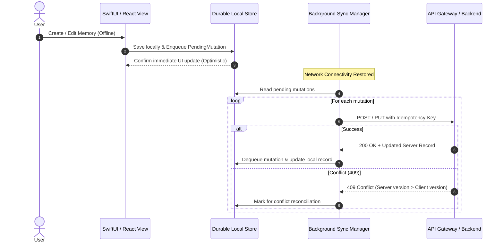

# Memoria — Offline-First & Synchronization Behavior

This document defines the offline mutation lifecycle, durable persistence guarantees, conflict resolution strategies, and synchronization protocol for **Memoria**.

---

## 1. Storage Invariant: Non-Ephemeral Persistence

**Rule:** User heirloom data and pending mutation queues must NEVER be placed in volatile cache directories (`.cachesDirectory` or browser session storage) that can be evicted by the operating system under memory pressure.

- **iOS Client**: Persisted in `FileManager.SearchPathDirectory.applicationSupportDirectory/MemoriaArchive/`.
- **Web Client**: Persisted in persistent browser `IndexedDB` (`memoria_offline_db`).

---

## 2. Durable Pending-Operation Queue

When a user creates, edits, or deletes a memory or book layout while offline:

---

## 3. Optimistic Concurrency & Conflict Handling

Memoria uses optimistic concurrency based on timestamped versioning (`updatedAt` and `version`):

1. **Clean Fast-Forward**: If server record has not changed since client loaded it, the update is applied immediately.
2. **Conflict Detection**: If `server.updatedAt > client.originalUpdatedAt`, the server rejects with HTTP 409 Conflict, returning both records.
3. **Preservation Policy**: A client NEVER silently overwrites a newer server version. In cases where automatic merge is unsafe (e.g. conflicting story text edits), Memoria preserves both versions:
   - Server version remains active.
   - Client version is saved as a distinct draft snapshot titled `"[Conflicted Copy] <Title>"`, ensuring zero data loss.
