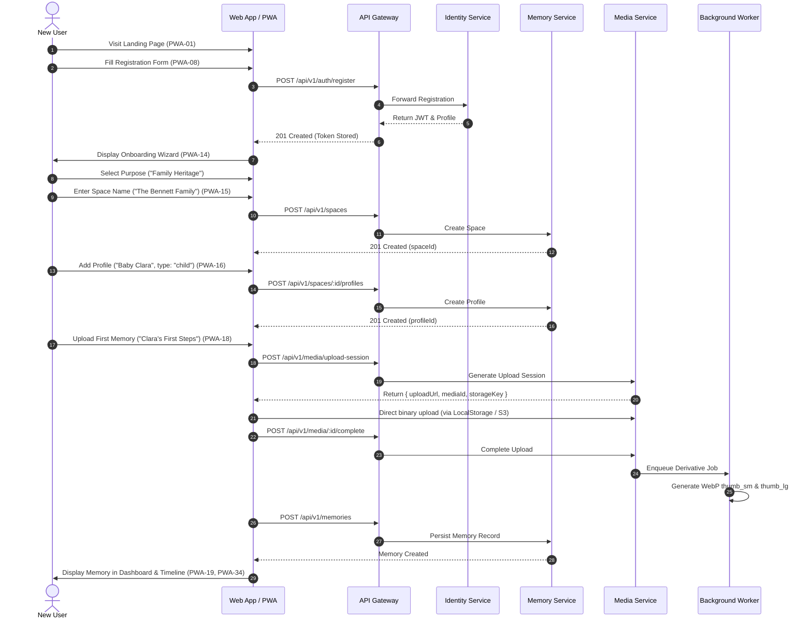

# End-to-End User Journeys & State Transition Specifications

## Journey 1: First-Time User Onboarding & First Memory

---

## Journey 2: Memory Preservation Lifecycle

1. **Capture/Selection**: User selects one or more items (photos, 4K video, voice recording, story, scanned documents).
2. **Quota Verification**: Client verifies that file size is within limits (Image ≤ 15MB, Audio ≤ 25MB, Video ≤ 50MB) and space quota (500MB max) is not exceeded.
3. **Metadata Association**: User assigns date captured (defaults to EXIF or current time), title, narrative story, location, tags, and links people/pet profiles.
4. **Resilient Background Processing**:
   - While user continues browsing, BullMQ processes derivatives asynchronously.
   - Status transitions: `pending_upload` → `uploaded` → `processing` → `ready`.
   - If processing encounters corrupted media, status becomes `failed` and PWA-42 provides actionable retry/recovery.
5. **Timeline & Indexing**: As soon as status is `ready`, memory is immediately rendered across Timeline (PWA-34), Grid (PWA-33), and Calendar (PWA-35).

---

## Journey 3: Family Collaboration & Permission Model

1. **Invitation Generation**: Space Owner enters invitee email and assigns role (`Contributor`).
2. **Acceptance**: Invitee receives link with secure cryptographically signed token and clicks `Accept` (PWA-13 / IOS-06).
3. **Scoped Workspace**: Contributor logs in and sees only the shared space and permitted collections.
4. **Contribution**: Contributor uploads memories and tags family members.
5. **Attribution & Audit**: System attaches `authorId` to the memory. PWA-54 renders complete change history ("Uploaded by Uncle Robert on Oct 14").
6. **Discussion**: Members comment and leave voice reactions (PWA-55 / IOS-42).

---

## Journey 4: Creative Book Studio & 3D Interactive Reader

1. **Initiation**: User clicks `Create Book` (PWA-58 / IOS-45) and selects format (`hardcover_standard_8x10`).
2. **Curated Memory Injection**: User selects memories from space or collection. The layout engine auto-distributes memories chronologically across spreads.
3. **Cover Crafting**: User selects cloth material (`#304C43` Forest Green with Gold Foil debossing) in Cover Studio (PWA-63).
4. **Spread Fine-Tuning**: In the 2D Editor (PWA-64), user adjusts image placement, crops margins, customizes captions, and adds quote elements.
5. **Interactive 3D Switch**: User toggles `3D Reader` (PWA-68 / IOS-49).
   - Three.js WebGL / RealityKit initializes the realistic physical book mesh.
   - Front cover opens with dynamic hinge shadow.
   - User drags page corner; vertex shader computes conical curvature and realistic curl deformation.
   - Pages display exact images and typography configured in the 2D editor.

---

## Journey 5: Physical Book Publishing & Order Fulfillment

1. **Preflight Audit**: User clicks `Prepare for Print` (PWA-69). Engine validates:
   - Trim & bleed dimensions (0.125 inch bleed).
   - Minimum 300 DPI for all photos.
   - Safe text margin (0.5 inch from edge, 0.75 inch from gutter).
   - Total page count is a multiple of 4.
2. **Edition Freeze**: Backend generates cryptographic SHA-256 hash of the complete book document snapshot and sets `isFrozenForPrint = true`. Subsequent digital edits spawn a new draft version without affecting the print order.
3. **Checkout & Shipping**: User enters shipping destination (PWA-72) and completes order (PWA-73).
4. **Order Tracking**: Order transitions from `preflight_passed` → `sent_to_press` → `bound` → `shipped` (PWA-75).
