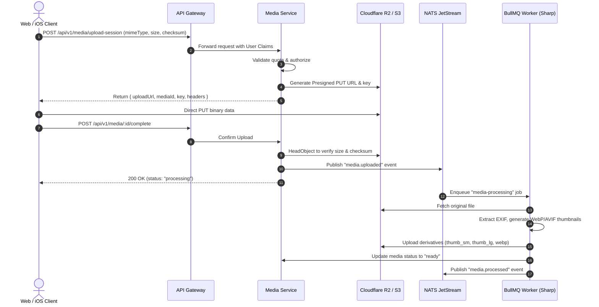

# Storage & Media Processing Pipeline

## 1. Direct-to-Storage Upload Lifecycle

To ensure API Gateway stability and support high-volume uploads of 4K videos, high-resolution family photos, and audio recordings, clients upload directly to Cloudflare R2 / S3 via authorized presigned sessions.

## 2. Derivative Specifications

- **Raw Original**: Stored in cold/private tier (`originals/{spaceId}/{mediaId}/raw.ext`).
- **Thumbnail (Small)**: 320x320 WebP, aspect-fill, 80% quality for grid and timeline previews.
- **Thumbnail (Large)**: 1280x1280 WebP, max-fit, 85% quality for memory detail viewing.
- **Book Print Master**: 300+ DPI preserved for physical book rendering.
- **Color Palette & Blurhash**: Extracted during worker processing and stored in database for instantaneous layout placeholders.
